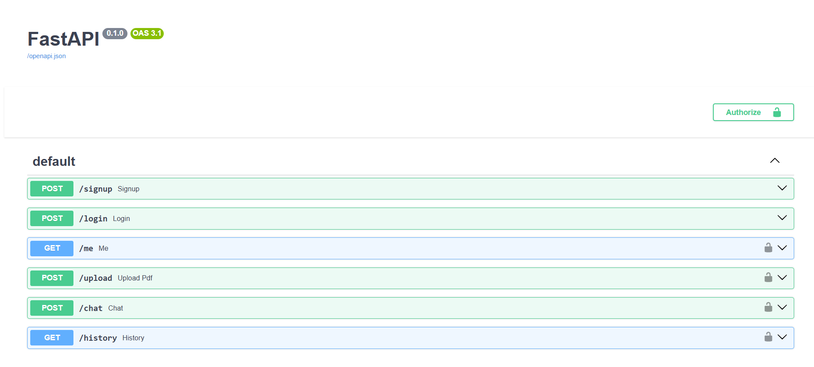
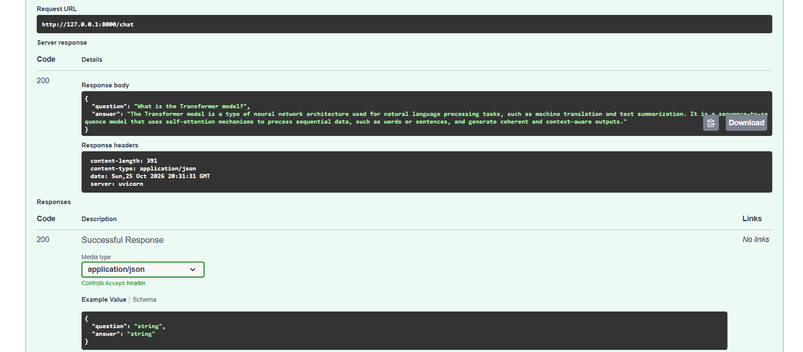

# RAG Chatbot Backend API

A secure REST backend built with **FastAPI, PostgreSQL and JWT authentication** that serves a local RAG chatbot to multiple users. Each user uploads their own PDFs and chats with them.

## Problem
A RAG chatbot running as a local script can't serve multiple users, keep their documents separate, remember conversations or restrict access.

## Solution
A backend API that adds user accounts, token-based login, per-user document indexes and per-user chat history around a local RAG pipeline.

## How it works
1. A user signs up and logs in, and gets a JWT access token
2. `POST /upload` splits a PDF into chunks and stores their embeddings in a per-user ChromaDB collection
3. `POST /chat` retrieves the 3 most relevant chunks from that user's collection and sends them with the question to a local Llama 3.2 model through Ollama
4. The question and answer are saved in PostgreSQL and listed by `GET /history`

## Features
- Signup and login with bcrypt-hashed passwords
- JWT access tokens with a 30-minute expiry
- Protected routes: `/me`, `/upload`, `/chat`, `/history`
- Per-user vector collections: one user can never retrieve another user's documents
- Per-user chat history stored in PostgreSQL through SQLAlchemy
- Fully local inference (Ollama), no external LLM API

## Tech stack
FastAPI, Uvicorn, PostgreSQL, SQLAlchemy, Pydantic, python-jose (JWT), passlib/bcrypt, LangChain, ChromaDB, HuggingFace embeddings (all-MiniLM-L6-v2), Ollama (llama3.2:1b)

## API routes
| Method | Route | Auth | Purpose |
|---|---|---|---|
| POST | /signup | No | Create an account |
| POST | /login | No | Get an access token |
| GET | /me | Yes | Current user info |
| POST | /upload | Yes | Upload a PDF and index it for your account |
| POST | /chat | Yes | Ask a question about your PDFs |
| GET | /history | Yes | List your past chats |

## Screenshots



## Project structure
```
app/
  main.py         routes
  auth.py         password hashing and JWT
  database.py     PostgreSQL connection
  models.py       database tables (User, ChatMessage)
  schemas.py      request/response shapes
  rag_service.py  PDF ingestion and RAG answering
```

## Security notes
- Passwords are stored only as bcrypt hashes
- Tokens are signed with a secret key and expire after 30 minutes
- Secrets live in `.env`, which is excluded from git
- Chat history and vector search are both filtered by the logged-in user

## Run locally
1. Install PostgreSQL and create a database named `ragchatbot_db`
2. Install Ollama and run `ollama pull llama3.2:1b`
3. Copy `.env.example` to `.env` and fill in your values
4. Generate a secret key: `python -c "import secrets; print(secrets.token_hex(32))"`
5. `python -m venv venv`, then `venv\Scripts\activate`
6. `pip install -r requirements.txt`
7. `uvicorn app.main:app --reload`
8. Open http://127.0.0.1:8000/docs

## Next improvements
Source citations in answers, multi-file management per user, and deployment.